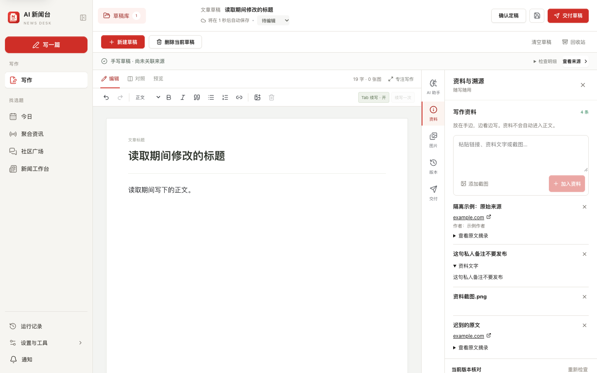
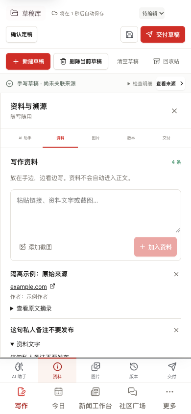

# 写作到交付的隔离验收

所有文字、链接和图片均为人工构造的测试数据，无真实稿件、账号或来源。

第一批：资料入口直接进入编辑器；截图和链接随稿件保存。以下由 `tests/e2e/reference-intake.test.ts` 在 1440 × 900 与 390 × 844 生成，未触发模型或平台写入。

第一批本地验证：单元测试 1437/1437、编辑评测 22/22、隔离构建成功、浏览器测试 18/18。正式服务未部署。

统一交付入口：`unified-delivery-1440.png` 与 `unified-delivery-390.png`。来自 `tests/e2e/delivery.test.ts` 的合成稿和假平台，未使用真实资料、账号或网络交付。展示配置默认折叠状态，头条在本批仍为入口。
